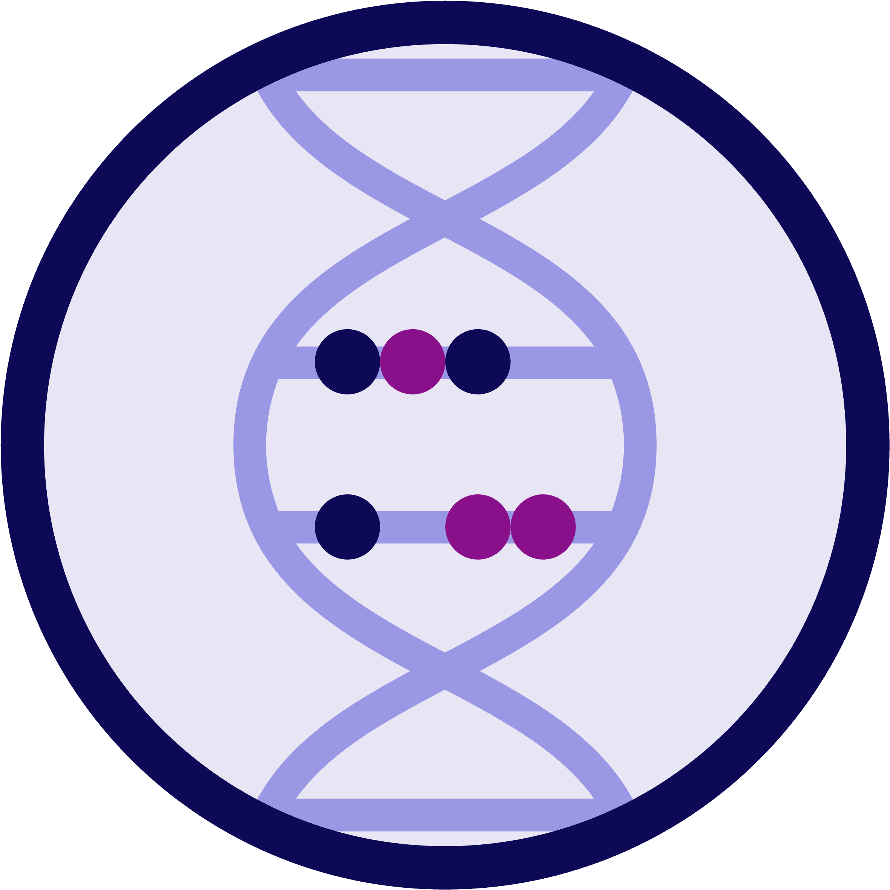

# Abacus

[](https://github.com/MOMA-AUH/abacus/actions/workflows/ci.yml)
[](https://anaconda.org/bioconda/abacus-str)
[](https://anaconda.org/bioconda/abacus-str)
[](./LICENSE)



## Description

Abacus analyzes STR (Short Tandem Repeat) data from Long-Read Sequencing. It targets Oxford Nanopore (ONT) data and has also been tested on Pacific Biosciences (PacBio) data. The main goal of Abacus is to provide a user-friendly interface for analyzing STR data and to provide a comprehensive report of the analysis results.

Abacus converts each entry of an STR catalog (JSON) into a graph, then re-maps relevant reads from an aligned BAM/CRAM file onto that graph using [minigraph](https://github.com/lh3/minigraph). Repeat counts per read are derived from the resulting path, and used to cluster reads into haplotypes, and STR alleles are called from these groups.

### Haplotyping algorithm

The haplotyping pipeline proceeds in three stages.

**Stage 1 — Outlier removal (preprocessing)**

Reads are grouped into two clusters (H1 and H2) via a Gaussian mixture model fit to the repeat counts. Two outlier removal steps then clean the read set iteratively, re-estimating model parameters and re-grouping after each removal. At most 1 read is removed per cluster per iteration to prevent over-filtering. Both steps are controlled by `--min-n-length-outlier-detection`, the minimum number of reads per haplotype group required to run outlier detection for that group.

1. **Singleton cluster removal**: a haplotype cluster with exactly one read is treated as an outlier; the read is removed and reads are re-grouped.
2. **Length outlier detection**: for each group (H1, H2, or HOM), the median STR base-pair length is computed across spanning reads. A read is flagged as an outlier if it falls outside both Tukey-fence robust bounds *and* a tolerance window of `median × (1 ± tolerance)`, set via `--length-outlier-tolerance`.

**Stage 2 — Length-based heterozygosity test**

A log-likelihood ratio test (LRT) compares a homozygous model (single Gaussian) against a heterozygous model (two Gaussians). If significant (p < `--heterozygosity-alpha`), reads keep their H1/H2 assignments; otherwise all reads are re-tagged HOM and Stage 3 is attempted.

**Stage 3 — Equal-length sequence split test (backup)**

When Stage 2 is not significant — haplotypes have the same repeat count — Abacus attempts a sequence-level split. A partial-order alignment (POA) MSA is built from all reads, the most variable kmer position is identified, and a binomial test (H₀: p = 0.5) is applied to the two most common kmers at that position:

- **Not significant (p ≥ alpha)**: the observed split is consistent with a 50/50 split — two alleles of equal length but distinct sequence. Reads are tagged H1/H2 by which kmer they carry; reads carrying neither are filtered (`not_split_base`).
- **Significant (p < alpha)**: ratio deviates from 50/50, no split is made, locus is called homozygous.

Controlled by `--equal-length-alpha`.

### Reporting results

Results are saved as an HTML report (STR loci, called alleles, and visualizations) and a VCF file with the genotyping calls (see [VCF output](#vcf-output)). `--add-consensus-to-vcf` adds the consensus sequences to the VCF output. For large catalogs, report generation can be skipped by omitting the `--report` argument.

## Installation

### Via conda (recommended)
```sh
conda install bioconda::abacus-str
```

### From source
To set up the environment for this project, follow these steps:

1. Clone the repository:
    ```sh
    git clone https://github.com/MOMA-AUH/abacus
    cd abacus
    ```

2. Create and activate the conda environment using the provided `env.yml` file:
    ```sh
    conda env create -f env.yml -n abacus
    conda activate abacus
    ```

3. Install Abacus using `pip`:
    ```sh
    pip install .
    ```

## Basic usage
Core arguments:

- `--bam`: BAM or CRAM file with aligned reads.
- `--ref`: reference FASTA used to align the reads.
- `--report` *(optional)*: HTML output path. Omit to skip report generation (useful for large catalogs).
- `--vcf`: VCF output path for the STR genotyping results.
- `--sample-id`: sample identifier.
- `--sex`: sample sex, `XX` or `XY` (default: `XX`).
- `--loci-subset`: restrict to a subset of loci. Repeat for multiple loci.
- `--str-catalog` *(optional)*: path to a custom STR catalog JSON. Defaults to the built-in catalog. Run `abacus --show-catalog` to print the built-in catalog to stdout as a starting point.

### Example 1: Analyze all loci
```sh
abacus \
    --bam input.bam \
    --ref reference.fa \
    --report output.html \
    --vcf output.vcf \
    --sample-id my_sample
```

### Example 2: Analyze a subset of loci (FGF14 and RFC1) in male
```sh
abacus \
    --bam input.bam \
    --ref reference.fa \
    --report output.html \
    --vcf output.vcf \
    --sample-id my_sample \
    --sex XY \
    --loci-subset FGF14 \
    --loci-subset RFC1
```

### Example 3: Use a custom catalog
```sh
# Save the built-in catalog to use as a starting point
abacus --show-catalog > my_catalog.json

# Run with a custom catalog
abacus \
    --bam input.bam \
    --ref reference.fa \
    --str-catalog my_catalog.json \
    --report output.html \
    --vcf output.vcf \
    --sample-id my_sample
```

### Configuration parameters
Fine-tuning knobs for the analysis:

#### Graph and Anchor Parameters
- `--anchor-length`: length of the left/right anchor sequences. Default: `500`.
- `--min-anchor-overlap`: minimum read/anchor overlap. Default: `200`.
- `--min-end-qual`: minimum base quality at read ends, used for trimming. Default: `17`.
- `--trim-window-size`: window size for trimming low-quality bases. Default: `10`.
- `--max-trim`: max bases trimmed from read ends. Default: `50`.

#### Quality Control Parameters
- `--min-str-qual`: minimum mean base quality in the STR region; lower is filtered out. Default: `20`.
- `--tol-str-qual`: tolerance for mean base quality in the STR region. Default: `30`.
- `--min-q10-str-quality`: minimum Q10 base quality in the STR region. Default: `15`.
- `--tol-q10-str-quality`: tolerance for Q10 base quality in the STR region. Default: `30`.
- `--max-error-rate`: max allowed error rate in the STR region; higher is filtered out. Default: `0.01`.
- `--tol-error-rate`: tolerance for error rate in the STR region. Default: `0.005`.
- `--max-ref-divergence`: max allowed reference divergence in the STR region. Default: `0.34`.
- `--length-outlier-tolerance`: fraction of the haplotype median STR base-pair length; reads within `median × (1 ± tolerance)` are always kept, even outside the Tukey-fence bounds. Default: `0.10` (10%).
- `--min-n-qc-filtering`: minimum read calls required to run statistical QC filtering. Default: `10`.
- `--min-n-length-outlier-detection`: minimum spanning reads per haplotype group to run length outlier detection. Default: `5`.

#### Haplotype Parameters
- `--min-haplotyping-depth`: minimum depth per called haplotype; below this the locus is called homozygous. Default: `10`.
- `--heterozygosity-alpha`: sensitivity cutoff for the length-based heterozygosity test. Default: `0.05`.
- `--equal-length-alpha`: sensitivity cutoff for the equal-length sequence split test (backup test for equal-length haplotypes). Default: `0.05`.

#### Coverage Parameters
- `--downsample`: randomly downsample reads per locus above this count; useful for high-coverage data (e.g. PacBio PureTarget). `0` disables downsampling. Default: `1000`.
- `--downsample-seed`: random seed for downsampling, for reproducibility. Default: `42`.

#### Output Options
- `--log-file`: path to the log file. Default: `abacus.log`.
- `--keep-temp-files`: keep temporary analysis files. Default: `False`.
- `--add-consensus-to-vcf`: add the consensus sequence of each allele (`CONS`) to the VCF output. Default: `False`.

## VCF output

The VCF follows [VCFv4.5](https://samtools.github.io/hts-specs/VCFv4.5.pdf) and uses its `<CNV:TR>` tandem repeat representation. There is one record per satellite (repeat) of a locus, and one `<CNV:TR>` ALT allele per haplotype: `H1,H2` for a heterozygous locus, a single allele for a homozygous one. Every allele is reported as ALT, also when it matches the reference, so the repeat count estimate is always present.

Example: the HTT CAG satellite, where H1 is `(CAG)9CAA(CAG)8` and H2 is `(CAG)42`:

```
chr4  3074876  Abacus.HTT.1  C  <CNV:TR>,<CNV:TR>  .  PASS  SVLEN=57,57;RN=3,1;RUS=CAG,CAA,CAG,CAG;RUC=9,1,8,42;LPSRUS=CAG,CAG;LPSRUC=9,42;TRUC=18.1,41.7;CITRUC=-0.9,1.1,-2.4,3;LOCUSID=HTT;REPID=HTT_CAG  GT:PS:DP:AD:ADSP:ADFL  1|2:3074876:30:0,18,12:0,15,9:0,3,3
```

| Column / field | Description |
|---|---|
| `POS`, `REF` | The padding base immediately preceding the repeat. |
| `ID` | `Abacus.<LocusId>.<satellite index>`. |
| `INFO/SVLEN` | Reference length of the repeat (`1` for a repeat absent from the reference). |
| `INFO/RN` | Number of repeat sequences in each allele. `0` for an allele without a consensus. |
| `INFO/RUS`, `INFO/RUC` | Repeat unit sequence and count of each repeat sequence, flattened in allele order. The consensus is split into runs of identical repeat units, so interruptions (e.g. `CAA`) and motif changes (e.g. RFC1 `AAAAG` to `AAGGG`) get their own entry. |
| `INFO/LPSRUS`, `INFO/LPSRUC` | Repeat unit sequence and count of the longest pure segment of each allele (see [Longest pure segment](#longest-pure-segment)). `.` for an allele without a consensus. |
| `INFO/TRUC` | Estimated total number of repeat units in each allele. |
| `INFO/CITRUC` | Confidence interval around `TRUC`, as lower and upper offsets from it for each allele. |
| `INFO/CONS` | Consensus sequence of each allele. Only with `--add-consensus-to-vcf`. |
| `INFO/LOCUSID`, `INFO/REPID` | The catalog `LocusId` and `VariantId`. |
| `INFO/STRSTATUS` | `normal`, `intermediate` or `pathogenic` for each allele, from `TRUC` and the catalog thresholds (see [Thresholds](#thresholds)). Only for satellites with thresholds. |
| `INFO/BENIGNMAX`, `INFO/PATHOGENICMIN` | The catalog `BenignMax` and `PathogenicMin`. Only when set for the satellite. |
| `FORMAT/GT` | `1\|2` (phased) for a heterozygous locus, `1/1` for a homozygous one. |
| `FORMAT/PS` | Phase set, shared by all satellite records of a heterozygous locus, so H1/H2 are consistent across them. |
| `FORMAT/DP` | Number of reads assigned to the alleles. |
| `FORMAT/AD` | Reads per allele, starting with the reference allele, which is always `0`. |
| `FORMAT/ADSP`, `FORMAT/ADFL` | Spanning and flanking reads per allele, starting with the reference allele like `AD`. |

### Longest pure segment

`LPSRUS`/`LPSRUC` give the longest pure segment (LPS) of each allele, i.e. the longest entry in `RUS`/`RUC`. The idea is from [Danzi et al. (2025)](https://doi.org/10.1101/2025.01.06.631535), who found the LPS to be the best genome-wide predictor of pathogenicity. As in the paper, the LPS can be used to rank loci by their variability in a population (PLVI), and to prioritise alleles with an LPS that is long compared to the population. Population LPS data per locus can be found in [TRExplorer](https://trexplorer.broadinstitute.org).

## The STR catalog

The STR catalog is a JSON file describing the STR loci to analyze. Each entry contains:

- `LocusId`: unique identifier for the locus, used to refer to it in the analysis results.
- `LocusStructure`: the locus structure, with each repeat unit in parentheses followed by `*`. E.g. ATXN1: `(CTG)*`. Repeat units can be any length and use [IUPAC](https://en.wikipedia.org/wiki/International_Union_of_Pure_and_Applied_Chemistry) base symbols (e.g. `N`, `Y`), and the structure can include non-repeating flanking/interrupting sequence — e.g. HTT: `(CAG)*CAACAG(CCG)*`, where `CAACAG` interrupts the two repeat units. The `|` operator specifies alternative repeat sequences within a unit, e.g. `(CAG|CAA)*` counts both `CAG` and `CAA` toward the repeat count.
- `ReferenceRegion`: the locus's region(s) in the reference genome, as `chr:start-end` (0-based, half-open, like BED). A list of regions can be given to cover the full structure.

A built-in catalog ships with the package and is used by default. Run `abacus --show-catalog > my_catalog.json` to export it as a starting point, or write your own from scratch following the format above. Example:

```json
[
    {
        "LocusId": "ATXN1",
        "LocusStructure": "(CTG)*",
        "ReferenceRegion": "chr6:16327635-16327722"
    },
    {
        "LocusId": "HTT",
        "LocusStructure": "(CAG)*CAACAG(CCG)*",
        "ReferenceRegion": [
            "chr4:3074876-3074933",
            "chr4:3074939-3074966"
        ]
    }
]
```

Entries with a `_complex` suffix (e.g. `FGF14_complex`, `RFC1_complex`) are more detailed versions of the plain entry with the same name, declaring known alternative motifs, interruptions and flanking sequences. See [Notes on FGF14](#notes-on-fgf14) and [Notes on RFC1](#notes-on-rfc1).

When declaring alternative motifs with `|`, avoid including a motif together with one of its rotations (e.g. `ACAGG` and `GGACA`, the same repeat read from a different starting base). The aligner then picks between them arbitrarily, so the same allele can be reported as different motifs.

### Thresholds

Optionally, a locus can have repeat-count thresholds:

- `BenignMax`: largest benign repeat unit count.
- `PathogenicMin`: smallest pathogenic repeat unit count.

Each count estimate is then classified as `normal` (≤ `BenignMax`), `intermediate` (between the two) or `pathogenic` (≥ `PathogenicMin`). Either field can be left out: without `BenignMax` there is no intermediate range, and without `PathogenicMin` nothing is classified as pathogenic. In the report summary table, intermediate count estimates are highlighted in orange and pathogenic ones in red, and the VCF gets the `STRSTATUS`, `BENIGNMAX` and `PATHOGENICMIN` fields (see [VCF output](#vcf-output)).

For a single-satellite locus, give each threshold as a number. For a locus with several satellites, give a list with one value per satellite, in `LocusStructure` order, using `null` for satellites without a threshold. E.g. HTT, with thresholds on the CAG repeat only (values from [STRchive](https://strchive.org/loci/HD_HTT)):

```json
[
    {
        "LocusId": "HTT",
        "LocusStructure": "(CAG)*CAACAG(CCG)*",
        "ReferenceRegion": [
            "chr4:3074876-3074933",
            "chr4:3074939-3074966"
        ],
        "BenignMax": [26, null],
        "PathogenicMin": [36, null]
    }
]
```

The built-in catalog has no thresholds; you need to add your own. Sources for published thresholds include [STRchive](https://strchive.org) (benign, intermediate and pathogenic ranges per locus), [STRipy](https://stripy.org/database) and [GeneReviews](https://www.ncbi.nlm.nih.gov/books/NBK1116/).

Thresholds are compared with the repeat unit count that Abacus reports for that satellite, so they must fit how the satellite is defined in the catalog. Published thresholds are based on how the repeat was counted in the original studies, e.g. whether interruptions or adjacent/partial repeats are included. Where the catalog region or structure differs from that, the published values may need adjusting.

Not supported:
- Thresholds on the combined count of several satellites.
- Pathogenicity determined by repeat motif rather than size (e.g. RFC1, or the `TTTCA` insertions at FAME loci).

## Other Resources

- [gnomAD STR browser](https://gnomad.broadinstitute.org/short-tandem-repeats?dataset=gnomad_r4) — population-level STR variation from gnomAD v4
- [STRipy database](https://stripy.org/database) — curated database of pathogenic STR loci
- [TRexplorer](https://trexplorer.broadinstitute.org) — Tandem Repeat Explorer from the Broad Institute

## Notes on FGF14
FGF14 is a complex locus with multiple haplotypes and many variants. The [provided catalog](./src/abacus/str_catalogs/abacus_catalog.json) includes an `FGF14_complex` entry:

```json
[
    {
        "LocusId": "FGF14_complex",
        "LocusStructure": "(TAGTCATAGTACCCCAA|TAGTCATAGTACCA)*(GVA)*",
        "ReferenceRegion": [
            "chr13:102161565-102161565",
            "chr13:102161565-102161726"
        ]
    }
]
```
`FGF14_complex` includes the possible interruptions `GCA` and `GGA` and combines them into `(GVA)*` (`V` = A/C/G, matching whichever base appears at that position). It also adds a common set of flanking regions that are not present in the hg38 reference: `TAGTCATAGTACCCCAA` and `TAGTCATAGTACCA`, each length-matched so a clean `GAA`-phase repeat always follows immediately after.

The insertion `(TAGTCATAGTACCCCAA)*` is described in the following paper:
https://www.nature.com/articles/s41588-024-01808-5/figures/1

The interruptions `GCA` and `GGA`, the alternative flanking region `TAGTCATAGTACCA` and a lot of additional variation not yet captured by `FGF14_complex` are described in the following paper:
https://www.nature.com/articles/s41467-024-52148-1

## Notes on RFC1
RFC1 has one pentanucleotide repeat (`chr4:39348424-39348485`) but a wide range of observed motifs. `RFC1_complex` only includes motifs whose pathogenicity has been classified - benign, likely benign, likely pathogenic or pathogenic. Motifs of unknown pathogenicity are deliberately left out.

```json
[
    {
        "LocusId": "RFC1_complex",
        "LocusStructure": "(AAAAG|AAAGG|AAGGG|AGGGC|ACAGG|AAAGGG)*",
        "ReferenceRegion": "chr4:39348424-39348485"
    }
]
```

| Motif | Classification | Original source |
|---|---|---|
| `AAAAG` | Benign (reference motif) | Cortese et al. 2019 |
| `AAAGG` | Benign below 500 repeat units, likely pathogenic above | Cortese et al. 2019, Dominik et al. 2023 |
| `AAAGGG` | Likely benign | Abramzon et al. 2021 |
| `AGGGC` | Likely pathogenic | Scriba et al. 2023, Dominik et al. 2023 |
| `AAGGG` | Pathogenic | Cortese et al. 2019 |
| `ACAGG` | Pathogenic | Scriba et al. 2020 |

Classifications are taken from the review by [Delforge et al. 2024](https://doi.org/10.1016/j.neurol.2024.03.006) (Fig. 1), which compiles the original sources above. Note:
- The `AAAGG` 500-unit threshold isn't part of the locus structure; apply it to the reported count.
- The Māori pathogenic configuration `(AAAGG)10-25(AAGGG)exp(AAAGG)4-6` (Beecroft et al. 2020) is covered by the included motifs.
