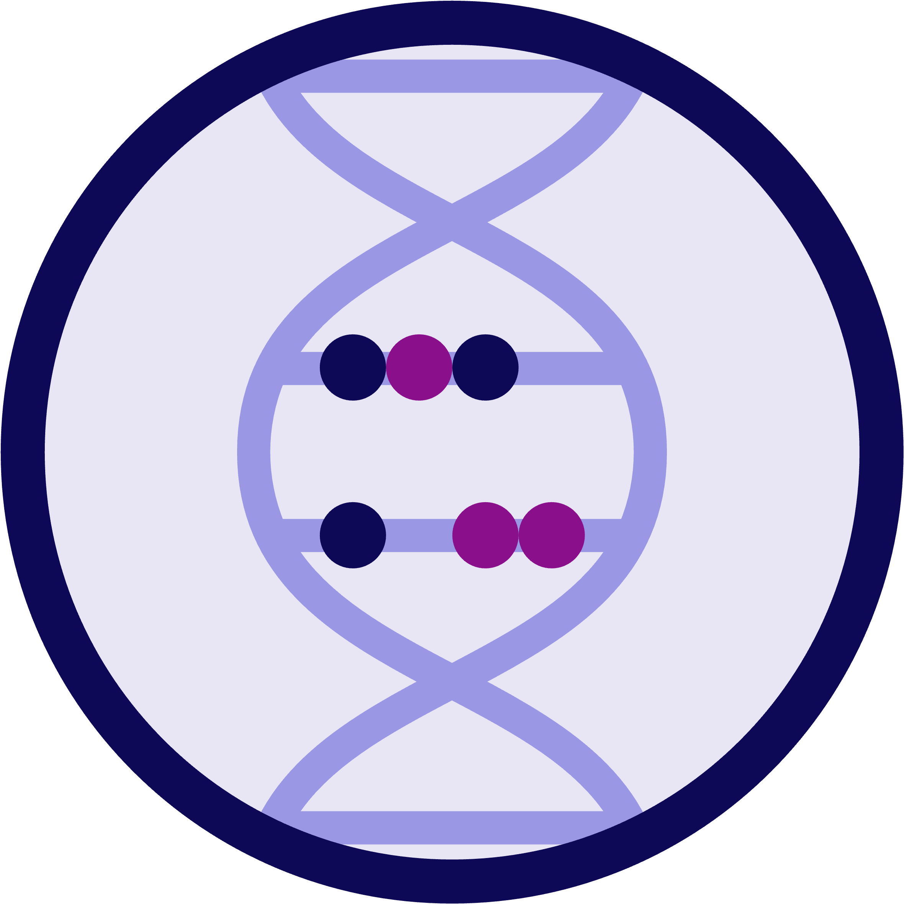

# Abacus

[](https://github.com/MOMA-AUH/abacus/actions/workflows/ci.yml)
[](https://anaconda.org/bioconda/abacus-str)
[](https://anaconda.org/bioconda/abacus-str)
[](./LICENSE)



Abacus calls short tandem repeat (STR) alleles from long-read sequencing data and produces an HTML report with comprehensive visualizations and a VCF file. Abacus ships with a built-in catalog of STR loci for hg38, but you can also provide your own catalog in JSON format. For each locus, Abacus reports the called alleles, their repeat counts with confidence intervals and consensus sequences.

Abacus is primarily designed for Oxford Nanopore (ONT) data but has also been tested on Pacific Biosciences (PacBio) data.

## Installation

### From conda
```sh
conda install bioconda::abacus-str
```

### From source

Install the dependencies with `env.yml`, then install Abacus with `pip`. The environment includes external tools that `pip` does not install.

```sh
git clone https://github.com/MOMA-AUH/abacus
cd abacus
conda env create -f env.yml -n abacus
conda activate abacus
python -m pip install --no-deps .
```

For development, clone with `--branch develop` and add `-e` to the pip command for an editable installation.

To update, activate the environment, run `git pull --ff-only` and `conda env update -f env.yml -n abacus`, then repeat the pip command.

## Basic usage

The main arguments are:

- `--bam`: BAM or CRAM file with aligned reads.
- `--ref`: reference FASTA used to align the reads.
- `--report` *(optional)*: HTML output path. Omit to skip report generation (useful for large catalogs).
- `--vcf`: VCF output path for the STR haplotyping results.
- `--sample-id`: sample identifier.
- `--sex`: sample sex, `XX` or `XY` (default: `XX`).
- `--loci-subset`: restrict to a subset of loci. Repeat for multiple loci.
- `--loci-subset-file`: path to a text file containing one locus ID per line.
- `--str-catalog` *(optional)*: path to a custom STR catalog JSON. Defaults to the built-in catalog. Run `abacus --show-catalog` to print the built-in catalog to stdout as a starting point.

### Example 1: Analyze all loci
```sh
abacus \
    --bam input.bam \
    --ref reference.fa \
    --report output.html \
    --vcf output.vcf \
    --sample-id my_sample
```

### Example 2: Analyze FGF14 and RFC1 in a male sample
```sh
abacus \
    --bam input.bam \
    --ref reference.fa \
    --report output.html \
    --vcf output.vcf \
    --sample-id my_sample \
    --sex XY \
    --loci-subset FGF14 \
    --loci-subset RFC1
```

### Example 3: Use a custom catalog
```sh
# Save the built-in catalog to use as a starting point
abacus --show-catalog > my_catalog.json

# Run with a custom catalog
abacus \
    --bam input.bam \
    --ref reference.fa \
    --str-catalog my_catalog.json \
    --report output.html \
    --vcf output.vcf \
    --sample-id my_sample
```

## Reporting results

The HTML report shows the STR loci, called alleles, and visualizations. Calls are also saved in a VCF file (see [VCF output](#vcf-output)). Use `--add-consensus-to-vcf` to include consensus sequences in the VCF. To skip the HTML report, for example when analyzing a large catalog, omit `--report`.

## VCF output

The VCF follows [VCFv4.5](https://samtools.github.io/hts-specs/VCFv4.5.pdf) and uses its `<CNV:TR>` tandem repeat representation. Each satellite (repeat) within a locus has one record, with one `<CNV:TR>` ALT allele per haplotype: two alleles (H1 and H2) for a heterozygous locus and one for a homozygous locus. All alleles are reported as ALT, including those that match the reference, so each has a repeat count estimate.

Example: the HTT CAG satellite, where H1 is `(CAG)9CAA(CAG)8` and H2 is `(CAG)42`:

```
chr4  3074876  Abacus.HTT.1  C  <CNV:TR>,<CNV:TR>  .  PASS  SVLEN=57,57;RN=3,1;RUS=CAG,CAA,CAG,CAG;RUC=9,1,8,42;LPSRUS=CAG,CAG;LPSRUC=9,42;TRUC=18.1,41.7;CITRUC=-0.9,1.1,-2.4,3;REFDIV=0.023,0.006;LOCUSID=HTT;REPID=HTT_CAG  GT:PS:DP:AD:ADSP:ADFL  1|2:3074876:30:0,18,12:0,15,9:0,3,3
```

| Column / field | Description |
|---|---|
| `POS`, `REF` | The padding base immediately preceding the repeat. |
| `ID` | `Abacus.<LocusId>.<satellite index>`. |
| `INFO/SVLEN` | Reference length of the repeat (`1` for a repeat absent from the reference). |
| `INFO/RN` | Number of repeat sequences in each allele. `0` for an allele without repeat sequences in this satellite. |
| `INFO/RUS`, `INFO/RUC` | Repeat unit sequence and count of each repeat sequence, flattened in allele order. The consensus is split into runs of identical repeat units, so interruptions (e.g. `CAA`) and motif changes (e.g. RFC1 `AAAAG` to `AAGGG`) get their own entry. |
| `INFO/LPSRUS`, `INFO/LPSRUC` | Repeat unit sequence and count of the longest pure segment of each allele (see [Longest pure segment](#longest-pure-segment)). `LPSRUC` is `0` for an allele without repeat sequences in this satellite; `LPSRUS` stays `.` — no segment, so no repeat unit. |
| `INFO/TRUC` | Estimated total number of repeat units in each allele. |
| `INFO/CITRUC` | Confidence interval around `TRUC`, as lower and upper offsets from it for each allele. |
| `INFO/REFDIV` | Divergence (0–1) of each allele's consensus from the catalog locus structure. Informational: a high value means the allele doesn't look like the catalog motif (e.g. a different or interrupted repeat), so its repeat counts should be read with care. |
| `INFO/CONS` | Consensus sequence of each allele. Only with `--add-consensus-to-vcf`. |
| `INFO/LOCUSID`, `INFO/REPID` | The catalog `LocusId` and `VariantId`. |
| `INFO/STRSTATUS` | `normal`, `intermediate` or `pathogenic` for each allele, from `TRUC` and the catalog thresholds (see [Thresholds](#thresholds)). Only for satellites with thresholds. |
| `INFO/BENIGNMAX`, `INFO/PATHOGENICMIN` | The catalog `BenignMax` and `PathogenicMin`. Only when set for the satellite. |
| `FORMAT/GT` | `1\|2` (phased) for a heterozygous locus, `1/1` for a homozygous one. |
| `FORMAT/PS` | Phase set, shared by all satellite records of a heterozygous locus, so H1/H2 are consistent across them. |
| `FORMAT/DP` | Number of reads assigned to the alleles. |
| `FORMAT/AD` | Reads per allele, starting with the reference allele, which is always `0`. |
| `FORMAT/ADSP`, `FORMAT/ADFL` | Spanning and flanking reads per allele, starting with the reference allele like `AD`. |

### No-calls

A locus with no reads gets a `./.` record with `FILTER` set to `NoReads`. If all reads were filtered out, the filter is `NoCall`. `DP` gives the number of reads at the locus, and the log explains why reads were removed.

### Longest pure segment

`LPSRUS`/`LPSRUC` give the longest pure segment (LPS) of each allele, i.e. the longest entry in `RUS`/`RUC`. [Danzi et al. (2025)](https://doi.org/10.1101/2025.01.06.631535) found the LPS to be the best genome-wide predictor of pathogenicity. It can be used to rank loci by their variability in a population (PLVI) and to prioritise alleles with an unusually long LPS relative to the population. [TRExplorer](https://trexplorer.broadinstitute.org) provides population LPS data for individual loci.

## The STR catalog

The STR catalog is a JSON file that defines the loci to analyze. Each entry contains:

- `LocusId`: unique identifier for the locus, used to refer to it in the analysis results.
- `LocusStructure`: the locus structure, with each repeat unit in parentheses followed by `*`. E.g. ATXN1: `(CTG)*`. Repeat units can be any length and use [IUPAC](https://en.wikipedia.org/wiki/International_Union_of_Pure_and_Applied_Chemistry) base symbols (e.g. `N`, `Y`), and the structure can include non-repeating flanking/interrupting sequence — e.g. HTT: `(CAG)*CAACAG(CCG)*`, where `CAACAG` interrupts the two repeat units. The `|` operator specifies alternative repeat sequences within a unit, e.g. `(CAG|CAA)*` counts both `CAG` and `CAA` toward the repeat count.
- `ReferenceRegion`: the locus's region(s) in the reference genome, as `chr:start-end` (0-based, half-open, like BED). A list of regions can be given to cover the full structure.

Abacus uses the built-in catalog by default. Export it with `abacus --show-catalog > my_catalog.json` to make your own changes, or write a catalog using the format above. For example:

```json
[
    {
        "LocusId": "ATXN1",
        "LocusStructure": "(CTG)*",
        "ReferenceRegion": "chr6:16327635-16327722"
    },
    {
        "LocusId": "HTT",
        "LocusStructure": "(CAG)*CAACAG(CCG)*",
        "ReferenceRegion": [
            "chr4:3074876-3074933",
            "chr4:3074939-3074966"
        ]
    }
]
```

Entries with a `_complex` suffix (e.g. `FGF14_complex`, `RFC1_complex`) describe the locus in more detail, including known alternative motifs, interruptions and flanking sequences. See [Notes on FGF14](#notes-on-fgf14) and [Notes on RFC1](#notes-on-rfc1).

When declaring alternative motifs with `|`, avoid including a motif together with one of its rotations (e.g. `ACAGG` and `GGACA`, the same repeat read from a different starting base). The aligner then picks between them arbitrarily, so the same allele can be reported as different motifs.

### Thresholds

You can add repeat-count thresholds to a locus:

- `BenignMax`: largest benign repeat unit count.
- `PathogenicMin`: smallest pathogenic repeat unit count.

Each count estimate is then classified as `normal` (≤ `BenignMax`), `intermediate` (between the two) or `pathogenic` (≥ `PathogenicMin`). Either field can be left out: without `BenignMax` there is no intermediate range, and without `PathogenicMin` nothing is classified as pathogenic. In the report summary table, intermediate count estimates are highlighted in orange and pathogenic ones in red, and the VCF gets the `STRSTATUS`, `BENIGNMAX` and `PATHOGENICMIN` fields (see [VCF output](#vcf-output)).

For a single-satellite locus, give each threshold as a number. For a locus with several satellites, give a list with one value per satellite, in `LocusStructure` order, using `null` for satellites without a threshold. E.g. HTT, with thresholds on the CAG repeat only (values from [STRchive](https://strchive.org/loci/HD_HTT)):

```json
[
    {
        "LocusId": "HTT",
        "LocusStructure": "(CAG)*CAACAG(CCG)*",
        "ReferenceRegion": [
            "chr4:3074876-3074933",
            "chr4:3074939-3074966"
        ],
        "BenignMax": [26, null],
        "PathogenicMin": [36, null]
    }
]
```

The built-in catalog has no thresholds. To add your own, sources for published thresholds include [STRchive](https://strchive.org) (benign, intermediate and pathogenic ranges per locus), [STRipy](https://stripy.org/database) and [GeneReviews](https://www.ncbi.nlm.nih.gov/books/NBK1116/).

Thresholds are compared with the repeat unit count that Abacus reports for that satellite, so they must fit how the satellite is defined in the catalog. Published thresholds depend on how the original studies counted the repeat, including whether they counted interruptions or adjacent or partial repeats. If your catalog uses a different region or structure, you may need to adjust those values.

Not supported:
- Thresholds on the combined count of several satellites.
- Pathogenicity determined by repeat motif rather than size (e.g. RFC1, or the `TTTCA` insertions at FAME loci).

## Notes on FGF14
FGF14 is a complex locus with multiple haplotypes and many variants. The [provided catalog](./src/abacus/str_catalogs/abacus_catalog.json) includes an `FGF14_complex` entry:

```json
[
    {
        "LocusId": "FGF14_complex",
        "LocusStructure": "(TAGTCATAGTACCCCAA|TAGTCATAGTACCA)*(GVA)*",
        "ReferenceRegion": [
            "chr13:102161565-102161565",
            "chr13:102161565-102161726"
        ]
    }
]
```
`FGF14_complex` includes the possible interruptions `GCA` and `GGA` and combines them into `(GVA)*` (`V` = A/C/G, matching whichever base appears at that position). It also adds a common set of flanking regions that are not present in the hg38 reference: `TAGTCATAGTACCCCAA` and `TAGTCATAGTACCA`, each length-matched so a clean `GAA`-phase repeat always follows immediately after.

The insertion `(TAGTCATAGTACCCCAA)*` is described in [this study (Fig. 1)](https://www.nature.com/articles/s41588-024-01808-5/figures/1).

[A second study](https://www.nature.com/articles/s41467-024-52148-1) describes the `GCA` and `GGA` interruptions, the alternative flanking region `TAGTCATAGTACCA`, and further variation not yet captured by `FGF14_complex`.

## Notes on RFC1
RFC1 has one pentanucleotide repeat (`chr4:39348424-39348485`) but a wide range of observed motifs. `RFC1_complex` only includes motifs whose pathogenicity has been classified - benign, likely benign, likely pathogenic or pathogenic. Motifs of unknown pathogenicity are deliberately left out.

```json
[
    {
        "LocusId": "RFC1_complex",
        "LocusStructure": "(AAAAG|AAAGG|AAGGG|AGGGC|ACAGG|AAAGGG)*",
        "ReferenceRegion": "chr4:39348424-39348485"
    }
]
```

| Motif | Classification | Original source |
|---|---|---|
| `AAAAG` | Benign (reference motif) | Cortese et al. 2019 |
| `AAAGG` | Benign below 500 repeat units, likely pathogenic above | Cortese et al. 2019, Dominik et al. 2023 |
| `AAAGGG` | Likely benign | Abramzon et al. 2021 |
| `AGGGC` | Likely pathogenic | Scriba et al. 2023, Dominik et al. 2023 |
| `AAGGG` | Pathogenic | Cortese et al. 2019 |
| `ACAGG` | Pathogenic | Scriba et al. 2020 |

The classifications come from [Delforge et al. 2024](https://doi.org/10.1016/j.neurol.2024.03.006) (Fig. 1), a review of the original sources listed above. Two details to keep in mind:
- The `AAAGG` 500-unit threshold isn't part of the locus structure; apply it to the reported count.
- The Māori pathogenic configuration `(AAAGG)10-25(AAGGG)exp(AAAGG)4-6` (Beecroft et al. 2020) is covered by the included motifs.

## Configuration parameters

The following options control read filtering, haplotyping, and output. Defaults are listed for each option.

### Graph and Anchor Parameters
- `--anchor-length`: length of the left/right anchor sequences. Default: `500`.
- `--min-anchor-overlap`: minimum read/anchor overlap. Default: `200`.
- `--min-end-qual`: minimum base quality at read ends, used for trimming. Default: `17`.
- `--trim-window-size`: window size for trimming low-quality bases. Default: `10`.
- `--max-trim`: max bases trimmed from read ends. Default: `50`.

### Quality Control Parameters
- `--min-str-qual`: minimum mean base quality in the STR region; lower is filtered out. Default: `17`.
- `--tol-str-qual`: tolerance for mean base quality in the STR region. Default: `35`.
- `--min-q10-str-quality`: minimum Q10 base quality in the STR region. Default: `7`.
- `--tol-q10-str-quality`: tolerance for Q10 base quality in the STR region. Default: `25`.
- `--max-error-rate`: max allowed error rate in the STR region; higher is filtered out. Default: `0.01`.
- `--tol-error-rate`: tolerance for error rate in the STR region. Default: `0.005`.
- `--tol-ref-divergence`: tolerance for reference divergence in the STR region; reads are only removed as divergence outliers above it. Default: `0.20`.
- `--length-outlier-tolerance`: fraction of the haplotype median STR base-pair length; reads within `median × (1 ± tolerance)` are always kept, even outside the Tukey-fence bounds. Default: `0.10` (10%).
- `--length-outlier-tolerance-bases`: absolute tolerance around the haplotype median STR base-pair length. Reads within either this window or the fractional window above are always kept. Default: `3` bases.
- `--min-n-qc-filtering`: minimum read calls required to run statistical QC filtering. Default: `5`.
- `--min-n-length-outlier-detection`: minimum spanning reads per haplotype group to run length outlier detection. Default: `5`.

### Haplotype Parameters
- `--min-reads-per-haplotype`: minimum usable reads required per reported haplotype; groups below this support are removed. Must be at least `1`. Default: `2`.
- `--min-haplotyping-depth`: minimum spanning-read depth to attempt the equal-length sequence split. Separate from `--min-reads-per-haplotype`. Default: `10`.
- `--heterozygosity-alpha`: sensitivity cutoff for the length-based heterozygosity test. Default: `0.05`.
- `--equal-length-alpha`: sensitivity cutoff for the equal-length sequence split test (backup test for equal-length haplotypes). Default: `0.05`.

### Coverage Parameters
- `--downsample`: randomly downsample reads per locus above this count; useful for high-coverage data (e.g. PacBio PureTarget). `0` disables downsampling. Default: `1000`.
- `--downsample-seed`: random seed for downsampling, for reproducibility. Default: `42`.

### Execution Options
- `--threads`: number of parallel worker processes; must be at least `1`. Default: `1`.
- `--verbose`: enable debug logging, including stage timings. Default: `False`.
- `--version`: show the installed Abacus version and exit.
- `--help`: show all CLI options and defaults.

### Output Options
- `--log-file`: path to the log file. Default: `abacus.log`.
- `--keep-summaries`: keep consensus, haplotype, heterozygosity test, and final/test parameter summary CSVs. Default: `False`.
- `--keep-read-summaries`: keep the read-level tables `reads.csv` and `filtered_reads.csv`. Default: `False`.
- `--add-consensus-to-vcf`: add the consensus sequence of each allele (`CONS`) to the VCF output. Default: `False`.

Tables kept with `--keep-summaries` and `--keep-read-summaries` are saved in `tmp_abacus_<vcf-stem>/` beside the VCF. Use both flags to keep all tables. Generating a report creates all tables temporarily; runs without a report create only the requested tables. Intermediate files are kept if a run fails.

Output is buffered and written to disk every 100 completed loci and when files are closed. Forcibly stopping a run may lose results still in the buffer.

## How Abacus works

Abacus builds a graph for each locus in the STR catalog, then remaps the relevant reads from an aligned BAM/CRAM file to that graph using [minigraph](https://github.com/lh3/minigraph). Haplotyping uses the resulting repeat counts and sequences to infer allele groups, refine their consensus sequences, and call STR alleles.

On flanking reads, a short terminal satellite run is trimmed and the read realigned if the run could instead be a partial copy of the neighbouring repeat motif. For example, at `(A)*(GAA)*`, one or two leading `A` bases before `GAA` copies are not counted as a separate A tract.

### Haplotyping algorithm

Each haplotype requires `--min-reads-per-haplotype` usable reads (default: `2`). Diploid loci with fewer than twice this minimum are fitted as one homozygous (HOM) group; fewer than the minimum produce no call. With the default minimum, two or three reads support a HOM call; four can support two haplotypes. Chromosome and sex determine biological ploidy.

1. **Allele grouping and filtering:** a Gaussian mixture model groups reads by repeat count. Groups and estimates remain provisional until consensus refinement finishes. Unsupported groups and length outliers are removed, then groups are refitted. Length outliers fall outside robust bounds and the wider window: `median × (1 ± tolerance)` (`--length-outlier-tolerance`) or `median ± bases` (`--length-outlier-tolerance-bases`). Filtering requires more than `--min-n-length-outlier-detection` spanning reads per group and removes at most one spanning and one overly long flanking read per iteration.

2. **Heterozygosity test:**

   - **a. Length test:** a likelihood ratio test compares homozygous and heterozygous models (one Gaussian versus two). Significant results (p < `--heterozygosity-alpha`) retain H1/H2; otherwise reads become HOM and the sequence test is attempted.

   - **b. Sequence test:** with at least `--min-haplotyping-depth` spanning reads (default: `10`), a partial-order alignment (POA) identifies a variable kmer position with usable alleles in at least 80% of covering reads. Internal deletions count as alleles; terminal gaps are treated as missing sequence. A binomial test checks the two commonest alleles for a 50/50 ratio. If p ≥ `--equal-length-alpha` and both groups meet minimum support, reads are split into H1/H2; reads carrying neither allele are filtered (`not_split_kmer`). Otherwise all reads remain HOM without filtering by this test.

3. **Consensus building:** each haplotype's consensus is built by hill-climbing over read kmers, independently for each satellite and break, then concatenating the results. Satellite lengths match the fitted repeat counts.

4. **Consensus refinement:** flanking reads and spanning reads with ambiguous length assignments can be reassigned to a strictly closer consensus, using edit distance in whole kmers and preserving ties. Confident spanning-read length assignments are protected. Spanning-read moves trigger parameter and length refitting. Minimum support is rechecked after splitting and reassignment; unsupported groups are removed before rebuilding consensus.

## Other Resources

- [gnomAD STR browser](https://gnomad.broadinstitute.org/short-tandem-repeats?dataset=gnomad_r4) — population-level STR variation from gnomAD v4
- [STRipy database](https://stripy.org/database) — curated database of pathogenic STR loci
- [TRexplorer](https://trexplorer.broadinstitute.org) — Tandem Repeat Explorer from the Broad Institute
